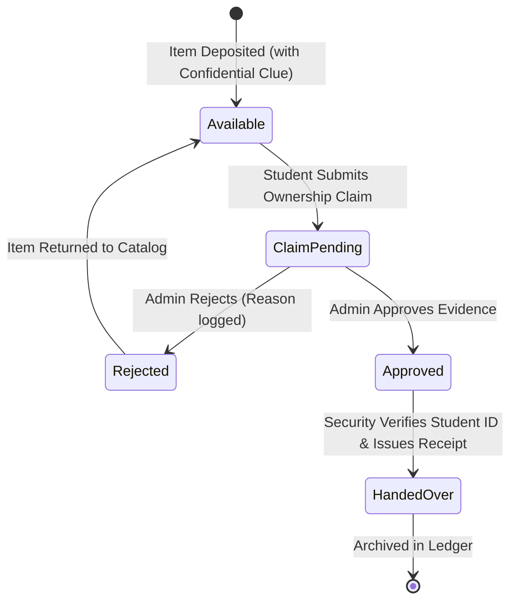

# 🎓 Campus Lost & Found Portal

> **Full-Stack Academic Project for Software Engineering (SE) & Advanced Web Technology (AWT)**  
> **Institution:** GSFC University (`@gsfcuniversity.ac.in`)  
> **Tech Stack:** React 19 (Vite) • Sass/SCSS • Express.js (CommonJS) • MongoDB Atlas / GridFS • Recharts • Lucide React

---

## 📋 Table of Contents
1. [Project Overview](#-project-overview)
2. [Team Members & Module Ownership](#-team-members--module-ownership)
3. [System Architecture](#-system-architecture)
4. [AWT & SE Syllabus Mapping](#-awt--se-syllabus-mapping)
5. [Core Features & Innovation](#-core-features--innovation)
6. [Technology Stack](#-technology-stack)
7. [Installation & Setup](#-installation--setup)
8. [Environment Variables](#-environment-variables)
9. [REST API Documentation](#-rest-api-documentation)
10. [Smart Matching Algorithm](#-smart-matching-algorithm)
11. [Claims & Handover Lifecycle](#-claims--handover-lifecycle)
12. [Evaluation & Demo Guide](#-evaluation--demo-guide)
13. [Production Deployment Guide](#-production-deployment-guide)

---

## 🌟 Project Overview

The **Campus Lost & Found Portal** is an enterprise-grade full-stack web application engineered to solve the chronic problem of misplaced belongings in university environments (lecture halls, laboratories, libraries, cafeterias, and sports complexes).

Unlike static message boards or unverified WhatsApp groups, this platform introduces:
- **Zero-knowledge proof verification:** Finders specify confidential distinguishing features (e.g., engraving, sticker inside sleeve, passcode hint) that are **strictly excluded** from public feeds and only visible to administrators and security personnel.
- **6-Factor Rule-Based Matching Engine:** Automatically correlates newly deposited found items against open lost reports and calculates a weighted similarity score (0–100%).
- **Three-Tier Custody Handover Protocol:** Involves Claimant claim submission, Admin evidence review, and in-person physical Security ID verification before issuing a cryptographically tracked digital receipt (`REC-GSFC-YYYYMMDD-XXXX`).
- **Domain Restricted Google GIS Authentication:** Limits portal access strictly to `@gsfcuniversity.ac.in` students and staff.

---

## 👥 Team Members & Module Ownership

| Team Member | Project Role | Core Modules & Responsibilities |
| :--- | :--- | :--- |
| **Nand Patel** | Lead Full-Stack & System Architect | Google OAuth 2.0 / GIS, JWT HttpOnly auth pipeline, RBAC (`student`, `admin`, `security`), Admin console, User management, Recharts analytics, system integration. |
| **Priyanshi** | Lost Items & Discovery Lead | Lost item reporting, categorized full-text catalog search, multi-param filtering, Item details view, image streaming. |
| **Krisha** | Found Items & AI Matching Lead | Found item intake, 6-factor rule-based smart matching engine, in-app notification center, Nodemailer automated match alert dispatching. |
| **Neerja** | Claims & Security Custodian Lead | Two-step ownership claim filing, confidential evidence comparison matrix, Security Desk physical locker inventory (A-01 through D-04), in-person ID check, digital handover receipts. |

---

## 🏛️ System Architecture

```text
                                 +---------------------------------------+
                                 |         GSFC University Client        |
                                 |     React 19 + Vite + SCSS Tokens     |
                                 +---------------------------------------+
                                                     |
                                   HTTPS / REST API  |  JWT in HttpOnly Cookie
                                                     v
+---------------------------------------------------------------------------------------------------+
|                                  Express.js API Gateway (Port 5000)                               |
|---------------------------------------------------------------------------------------------------|
|  [Rate Limiter] -> [CORS Policy] -> [Cookie Parser] -> [Auth Middleware (protect / authorize)]    |
|---------------------------------------------------------------------------------------------------|
|  /api/auth          : Google OAuth verifyIdToken & dev persona session switcher                   |
|  /api/categories    : Auto-seeding 9 campus property classes                                      |
|  /api/photos        : MongoDB GridFS chunked binary photo streaming (2 MB limit)                  |
|  /api/lost-items    : Public lost catalog with MongoDB $text indexing                             |
|  /api/found-items   : Intake with private verificationDetails exclusion                           |
|  /api/matches       : 6-factor similarity correlation engine                                      |
|  /api/claims        : Ownership verification workflow                                             |
|  /api/admin         : Aggregated Recharts analytics, user management, audit logs, announcements   |
+---------------------------------------------------------------------------------------------------+
                                                     |
                         Mongoose ODM Connection      |  GridFSBucket ('photos')
                                                     v
                                 +---------------------------------------+
                                 |       MongoDB Atlas / Local DB        |
                                 |  campus_lost_found (GridFS: photos)   |
                                 +---------------------------------------+
```

---

## 📚 AWT & SE Syllabus Mapping

This project was built to directly satisfy both **Advanced Web Technology (AWT)** and **Software Engineering (SE)** curriculum requirements:

### Advanced Web Technology (AWT) Concepts
| AWT Concept | Implementation File | Explanation |
| :--- | :--- | :--- |
| **React Components & JSX** | [`client/src/App.jsx`](file:///c:/Users/HP/.gemini/antigravity-ide/scratch/campus-lost-found/client/src/App.jsx) | Clean functional component architecture with JSX syntax and React Router v7. |
| **React Hooks** | [`client/src/pages/BrowseItems.jsx`](file:///c:/Users/HP/.gemini/antigravity-ide/scratch/campus-lost-found/client/src/pages/BrowseItems.jsx) | Heavy usage of `useState`, `useEffect`, `useCallback`, `useRef`, and custom `useAuth`. |
| **Class-Based ErrorBoundary** | [`client/src/components/ErrorBoundary.jsx`](file:///c:/Users/HP/.gemini/antigravity-ide/scratch/campus-lost-found/client/src/components/ErrorBoundary.jsx) | Class component implementing `componentDidCatch` and `getDerivedStateFromError`. Demonstrable via interactive button on Home page. |
| **React.memo Performance** | [`client/src/components/StatusBadge.jsx`](file:///c:/Users/HP/.gemini/antigravity-ide/scratch/campus-lost-found/client/src/components/StatusBadge.jsx) | Prevents unnecessary re-renders of high-frequency status indicators. |
| **Sass/SCSS Design System** | [`client/src/styles/App.scss`](file:///c:/Users/HP/.gemini/antigravity-ide/scratch/campus-lost-found/client/src/styles/App.scss) | Modular SCSS with design tokens (`_variables.scss`), responsive mixins (`_mixins.scss`), and dark modern gradients. |
| **Data Visualization** | [`client/src/pages/AdminDashboard.jsx`](file:///c:/Users/HP/.gemini/antigravity-ide/scratch/campus-lost-found/client/src/pages/AdminDashboard.jsx) | Recharts integration rendering `BarChart`, `AreaChart`, and `PieChart` (donut) with live aggregations. |
| **Express Middleware Pipeline** | [`server/src/middleware/auth.middleware.js`](file:///c:/Users/HP/.gemini/antigravity-ide/scratch/campus-lost-found/server/src/middleware/auth.middleware.js) | Chained `protect` (JWT validation) and `authorize('admin', 'security')` route guards. |
| **Centralized Error Handling** | [`server/src/middleware/error.middleware.js`](file:///c:/Users/HP/.gemini/antigravity-ide/scratch/campus-lost-found/server/src/middleware/error.middleware.js) | Express central error handler normalizing Mongoose `ValidationError`, `CastError`, and duplicate keys. |
| **MongoDB GridFS Binary Storage** | [`server/src/services/photo.service.js`](file:///c:/Users/HP/.gemini/antigravity-ide/scratch/campus-lost-found/server/src/services/photo.service.js) | Chunked streaming of user-uploaded item photos directly in MongoDB (`photos.files` and `photos.chunks`). |

### Software Engineering (SE) Methodologies
- **Requirements Engineering:** Clear SRS specifications for students, administrators, and security staff.
- **Role-Based Access Control (RBAC):** Strict separation of concerns (`student`, `admin`, `security`).
- **Traceability & Audit Logging:** Immutable security audit trail recording all privileged actions in `AuditLog`.
- **Automated Testing:** Unit and full end-to-end integration test suites (`test-phase6.js` and `test-e2e.js`).

---

## ⚡ Core Features & Innovation

1. **Confidential Ownership Clue Pattern:**
   Finders submit distinguishing features (e.g. "Contains 64GB SanDisk USB with roll number"). The backend query projections explicitly exclude this field (`.select('-verificationDetails')`) from public APIs. Only administrators reviewing claims can cross-verify this clue.
2. **Physical Locker Occupancy Manager:**
   Security guards manage 16 physical storage bins across 4 zones:
   - `Zone A (Electronics)`: Lockers A-01 to A-04 (Safe)
   - `Zone B (Wallets & IDs)`: Lockers B-01 to B-04 (Vault)
   - `Zone C (Keys & Accessories)`: Lockers C-01 to C-04 (Bin)
   - `Zone D (Bags & Sports)`: Lockers D-01 to D-04 (Bay)
3. **Digital Handover Receipts:**
   Upon verifying the claimant's student ID card in person, security staff issue a tamper-resistant receipt number: `REC-GSFC-YYYYMMDD-XXXX`.
4. **Campus Announcement Banner:**
   Administrators can broadcast priority announcements displayed across all student portals.

---

## 🛠️ Technology Stack

### Frontend
- **Framework:** React 19 + Vite 8
- **Routing:** React Router DOM v7
- **Styling:** SCSS (Sass 1.105) with CSS custom properties
- **Analytics & Charts:** Recharts 3.10
- **Icons:** Lucide React (feather-compatible SVG icons)
- **HTTP Client:** Axios with `withCredentials: true`

### Backend
- **Runtime:** Node.js (CommonJS modules)
- **Framework:** Express.js 4.19
- **Database ODM:** Mongoose 8.5
- **Authentication:** Google Auth Library (`OAuth2Client`) + JsonWebToken (JWT)
- **File Uploads:** Multer (memory storage) -> MongoDB GridFS Bucket (`photos`)
- **Email Delivery:** Nodemailer with console development fallback
- **Security:** Helmet-inspired headers, rate limiting, HttpOnly cookies

---

## 🚀 Installation & Setup

### 1. Prerequisites
- **Node.js:** v18.0.0 or later (Tested on Node v24)
- **npm:** v9.0.0 or later
- **MongoDB:** MongoDB Atlas connection URI or local MongoDB running on port 27017

### 2. Clone and Setup Backend
```powershell
# Navigate to server directory
cd server

# Install dependencies
npm install

# Configure environment
cp .env.example .env

# Start backend with nodemon
npm run dev
```
Backend runs on `http://localhost:5000`  
Health check: `http://localhost:5000/api/health`

### 3. Setup Frontend Client
```powershell
# Navigate to client directory
cd ../client

# Install dependencies
npm install

# Start Vite dev server
npm run dev
```
Frontend runs on `http://localhost:5173`

---

## 🔐 Environment Variables

### Backend (`server/.env`)
```env
PORT=5000
NODE_ENV=development
MONGO_URI=mongodb://localhost:27017/campus_lost_found
CLIENT_URL=http://localhost:5173
UNIVERSITY_EMAIL_DOMAIN=gsfcuniversity.ac.in
JWT_SECRET=campus_lost_found_jwt_super_secret_dev_key_2026
JWT_EXPIRES_IN=7d
COOKIE_SECRET=campus_lost_found_cookie_secret_key_2026
GOOGLE_CLIENT_ID=your-google-client-id.apps.googleusercontent.com
```

### Frontend (`client/.env`)
```env
VITE_API_BASE_URL=http://localhost:5000/api
VITE_GOOGLE_CLIENT_ID=your-google-client-id.apps.googleusercontent.com
VITE_PORTAL_NAME=Campus Lost & Found Portal
```

---

## 📡 REST API Documentation

### Public Endpoints
| Method | Endpoint | Description |
| :--- | :--- | :--- |
| `GET` | `/api/health` | Service uptime and database connectivity diagnostics. |
| `GET` | `/api/categories` | Returns seeded campus property classes with SVG icons. |
| `GET` | `/api/photos/:id` | Streams binary image from MongoDB GridFS bucket. |
| `GET` | `/api/lost-items` | Filterable list of lost items (supports `?search=`, `?category=`). |
| `GET` | `/api/found-items` | Filterable list of found items (excludes `verificationDetails`). |
| `GET` | `/api/admin/announcements` | Publicly broadcasts active campus notices. |

### Authenticated Student Endpoints
| Method | Endpoint | Description |
| :--- | :--- | :--- |
| `POST` | `/api/auth/google` | Verifies Google GIS ID token, checks `@gsfcuniversity.ac.in` domain, issues JWT. |
| `POST` | `/api/auth/dev-login` | Lab evaluation role switcher (`student`, `admin`, `security`). |
| `GET` | `/api/auth/me` | Fetches active authenticated user profile. |
| `POST` | `/api/lost-items` | Report a lost item with date, location, and photos. |
| `POST` | `/api/found-items` | Deposit a found item with secret verification clue. |
| `GET` | `/api/matches/item/:id` | Calculates and returns 6-factor similarity score against catalog. |
| `POST` | `/api/claims` | Submits ownership claim with proof description. |
| `GET` | `/api/claims/my` | Fetches student's submitted claims and statuses. |
| `GET` | `/api/notifications` | In-app notification center for match and claim alerts. |

### Administrator Endpoints (`admin` role required)
| Method | Endpoint | Description |
| :--- | :--- | :--- |
| `GET` | `/api/admin/analytics` | Aggregates KPIs, category distributions, monthly trends, and donut status data. |
| `GET` | `/api/admin/users` | Searchable user directory with role filters. |
| `PATCH` | `/api/admin/users/:id/role` | Promote/demote permissions between student, admin, security. |
| `PATCH` | `/api/admin/users/:id/block` | Suspend or reactivate user account. |
| `GET` | `/api/admin/audit-logs` | Immutable audit stream of all privileged administrative events. |
| `PATCH` | `/api/claims/:id/review` | Approve or reject student claim with recorded rationale. |
| `POST` | `/api/admin/announcements` | Publish a campus-wide banner announcement. |

### Security Desk Endpoints (`security` or `admin` role required)
| Method | Endpoint | Description |
| :--- | :--- | :--- |
| `GET` | `/api/claims?status=approved` | Approved claims awaiting in-person student verification. |
| `POST` | `/api/claims/:id/handover` | Verifies student ID in person, releases custody, generates receipt. |
| `GET` | `/api/claims?status=handed_over` | Permanent digital receipt archive. |

---

## 🧠 Smart Matching Algorithm

The rule-based matching engine (`matching.service.js`) computes a composite score (0–100%) across 6 distinct attributes:

$$\text{Total Score} = S_{\text{cat}} + S_{\text{name}} + S_{\text{brand}} + S_{\text{color}} + S_{\text{loc}} + S_{\text{date}}$$

| Factor | Weight | Scoring Mechanism |
| :--- | :---: | :--- |
| **Category** | **35%** | Exact ObjectId match = 35 pts; mismatch = 0 pts. |
| **Item Name** | **25%** | Case-insensitive token overlap & substring intersection (0 to 25 pts). |
| **Brand** | **15%** | Exact match = 15 pts; partial match = 8 pts. |
| **Primary Color**| **10%** | Exact or substring color equality = 10 pts. |
| **Location** | **10%** | Campus zone match (e.g., "Library", "Science Block") = 10 pts. |
| **Incident Date**| **5%** | Found date within 7 days of loss = 5 pts; within 14 days = 3 pts. |

Items scoring **$\ge 40\%$** trigger automatic match suggestions and generate in-app notifications.

---

## 🔄 Claims & Handover Lifecycle



---

## 🧪 Evaluation & Demo Guide

For academic review and viva examinations, pre-configured persona buttons are provided on the Login page:

1. **Student Mode:** Click **"Login as Student"**
   - Report a lost item (e.g. *HP Pavilion Laptop* in *Library*).
   - View automated match suggestions and file an ownership claim.
2. **Administrator Mode:** Click **"Login as Administrator"**
   - Access `/admin` to inspect real-time Recharts visualizations.
   - Review pending claims: Compare student's claim evidence against the finder's confidential clue.
   - Click **Approve Claim** and enter decision remarks.
3. **Security Staff Mode:** Click **"Login as Security Staff"**
   - Access `/security` to see the In-Person Handover Queue.
   - Enter verified student ID (e.g. `GSFCU-2023-BTECH-089`).
   - Confirm custody handover: Instant generation of digital receipt `REC-GSFC-YYYYMMDD-XXXX`.
   - Inspect the **Physical Storage Lockers** occupancy map.

### Running Automated Test Suites
```powershell
# In server/ directory:
node scripts/test-phase6.js    # Validates Recharts analytics, users & audit logs
node scripts/test-e2e.js       # Complete 10-step full-lifecycle integration test
```

---

## 🌐 Production Deployment Guide

### Frontend Deployment (Vercel)
1. Push project to GitHub.
2. Link the repository in **Vercel**.
3. Set **Root Directory** to `client`.
4. Set Build Command: `npm run build` and Output Directory: `dist`.
5. Add Environment Variable:
   - `VITE_API_BASE_URL=https://your-backend-service.onrender.com/api`

### Backend Deployment (Render)
1. In Render, create a new **Web Service** connected to your repo.
2. Set **Root Directory** to `server`.
3. Set Build Command: `npm install` and Start Command: `node src/server.js`.
4. Configure Environment Variables:
   - `NODE_ENV=production`
   - `MONGO_URI=mongodb+srv://<username>:<password>@cluster0.mongodb.net/campus_lost_found`
   - `CLIENT_URL=https://your-frontend-app.vercel.app`
   - `JWT_SECRET=your_production_secret`
   - `UNIVERSITY_EMAIL_DOMAIN=gsfcuniversity.ac.in`

---

## 📜 License
Developed for educational purposes at GSFC University. Academic Project © 2026.
