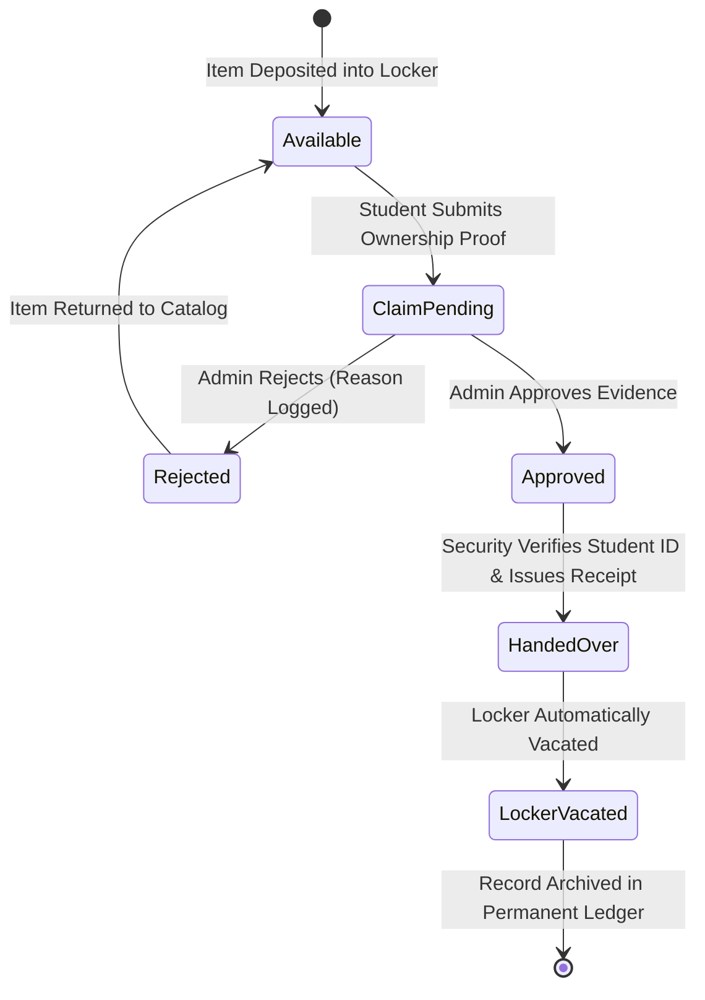

# 🎓 Campus Lost & Found Portal

> **Full-Stack Academic Project for Software Engineering (SE) & Advanced Web Technology (AWT)**  
> **Institution:** GSFC University (`@gsfcuniversity.ac.in`)  
> **Repository:** [https://github.com/PATEL-BTECH/OOPS-Lost-It-Portal-](https://github.com/PATEL-BTECH/OOPS-Lost-It-Portal-)  
> **Tech Stack:** React 19 (Vite) • Sass/SCSS • Express.js (CommonJS) • MongoDB Atlas / GridFS • Recharts • Lucide React

---

## 📋 Table of Contents
1. [Project Overview](#-project-overview)
2. [Team Members & Module Ownership](#-team-members--module-ownership)
3. [System Architecture](#-system-architecture)
4. [AWT & SE Syllabus Mapping](#-awt--se-syllabus-mapping)
5. [Core Features & Innovation](#-core-features--innovation)
6. [Technology Stack](#-technology-stack)
7. [Installation & Setup](#-installation--setup)
8. [Environment Variables](#-environment-variables)
9. [REST API Documentation](#-rest-api-documentation)
10. [Physical Custody & Storage Locker System](#-physical-custody--storage-locker-system)
11. [Smart Matching Algorithm](#-smart-matching-algorithm)
12. [Claims & Handover Lifecycle](#-claims--handover-lifecycle)
13. [Student Profile Onboarding & Role Elevation](#-student-profile-onboarding--role-elevation)
14. [Evaluation & Demo Guide](#-evaluation--demo-guide)
15. [Project Code Metrics (KLOC)](#-project-code-metrics-kloc)
16. [Production Deployment Guide](#-production-deployment-guide)

---

## 🌟 Project Overview

The **Campus Lost & Found Portal** is an enterprise-grade full-stack web application engineered to solve the chronic problem of misplaced belongings in university environments (lecture halls, laboratories, libraries, cafeterias, and sports complexes).

Unlike static message boards or unverified social media groups, this platform introduces:
- **Zero-knowledge proof verification:** Finders specify confidential distinguishing features (e.g., serial number suffix, engraving, inner sticker, passcode clue) that are **strictly excluded** from public feeds and only visible to administrators and security personnel.
- **6-Factor Rule-Based Matching Engine:** Automatically correlates newly deposited found items against open lost reports and calculates a weighted similarity score (0–100%).
- **Three-Tier Custody Handover Protocol:** Involves Claimant claim submission, Admin evidence review, and in-person physical Security ID verification before issuing a cryptographically tracked digital receipt (`REC-GSFC-YYYYMMDD-XXXX`).
- **Domain-Restricted Google GIS Authentication:** Limits portal access strictly to authorized `@gsfcuniversity.ac.in` students and staff.
- **Configurable Campus Custody Posts (Option B):** Tracks property flow across Main Gate, Central Admin Desk, Central Library, Science Block, and Sports Complex.
- **16 Physical Storage Lockers (Zones A–D):** Strict state-derived occupancy management linked to custody deposit and claim release.

---

## 👥 Team Members & Module Ownership

| Team Member | Project Role | Core Modules & Responsibilities |
| :--- | :--- | :--- |
| **Nand Patel** | Lead Full-Stack & System Architect | Google OAuth 2.0 / GIS, JWT HttpOnly auth pipeline, RBAC (`student`, `admin`, `security`), Admin console, User management, Recharts analytics, system integration. |
| **Priyanshi** | Lost Items & Discovery Lead | Lost item reporting, categorized full-text catalog search, multi-param filtering, Item details view, image streaming. |
| **Krisha** | Found Items & AI Matching Lead | Found item intake, 6-factor rule-based smart matching engine, in-app notification center, Nodemailer automated match alert dispatching. |
| **Neerja** | Claims & Security Custodian Lead | Two-step ownership claim filing, confidential evidence comparison matrix, Security Desk physical locker inventory (`LKR-A01` through `LKR-D04`), in-person ID check, digital handover receipts. |

---

## 🏛️ System Architecture

```text
                                 +---------------------------------------+
                                 |         GSFC University Client        |
                                 |     React 19 + Vite + SCSS Tokens     |
                                 +---------------------------------------+
                                                     |
                                   HTTPS / REST API  |  JWT in HttpOnly Cookie
                                                     v
+---------------------------------------------------------------------------------------------------+
|                                  Express.js API Gateway (Port 5000)                               |
|---------------------------------------------------------------------------------------------------|
|  [Rate Limiter] -> [CORS Policy] -> [Cookie Parser] -> [Auth Middleware (protect / authorize)]    |
|---------------------------------------------------------------------------------------------------|
|  /api/auth          : Google OAuth verifyIdToken, session diagnostics & profile completion        |
|  /api/categories    : Auto-seeding 9 campus property classes                                      |
|  /api/photos        : MongoDB GridFS chunked binary photo streaming (2 MB limit)                  |
|  /api/lost-items    : Public lost catalog with MongoDB $text indexing                             |
|  /api/found-items   : Intake with private verificationDetails exclusion                           |
|  /api/lockers       : 16 Physical Lockers (Zones A-D) & Option B custody intake locations         |
|  /api/matches       : 6-factor similarity correlation engine                                      |
|  /api/claims        : Ownership verification workflow & physical handover receipts                |
|  /api/admin         : Aggregated Recharts analytics, user management, audit logs, announcements   |
+---------------------------------------------------------------------------------------------------+
                                                     |
                         Mongoose ODM Connection      |  GridFSBucket ('photos')
                                                     v
                                 +---------------------------------------+
                                 |       MongoDB Atlas / Local DB        |
                                 |  campus_lost_found (GridFS: photos)   |
                                 +---------------------------------------+
```

---

## 📚 AWT & SE Syllabus Mapping

This project was built to directly satisfy both **Advanced Web Technology (AWT)** and **Software Engineering (SE)** curriculum requirements:

### Advanced Web Technology (AWT) Concepts
| AWT Concept | Implementation File | Explanation |
| :--- | :--- | :--- |
| **React Components & JSX** | [`client/src/App.jsx`](client/src/App.jsx) | Clean functional component architecture with JSX syntax and React Router v7. |
| **React Hooks** | [`client/src/pages/BrowseItems.jsx`](client/src/pages/BrowseItems.jsx) | Heavy usage of `useState`, `useEffect`, `useCallback`, `useRef`, and custom `useAuth`. |
| **Class-Based ErrorBoundary** | [`client/src/components/ErrorBoundary.jsx`](client/src/components/ErrorBoundary.jsx) | Class component implementing `componentDidCatch` and `getDerivedStateFromError`. |
| **React.memo Performance** | [`client/src/components/StatusBadge.jsx`](client/src/components/StatusBadge.jsx) | Prevents unnecessary re-renders of high-frequency status indicators. |
| **Sass/SCSS Design System** | [`client/src/styles/App.scss`](client/src/styles/App.scss) | Modular SCSS with design tokens (`_variables.scss`), responsive mixins (`_mixins.scss`), and modern gradients. |
| **Data Visualization** | [`client/src/pages/AdminDashboard.jsx`](client/src/pages/AdminDashboard.jsx), [`StudentDashboard.jsx`](client/src/pages/StudentDashboard.jsx) | Recharts integration rendering `BarChart`, `AreaChart`, and `PieChart` with live data. |
| **Express Middleware Pipeline** | [`server/src/middleware/auth.middleware.js`](server/src/middleware/auth.middleware.js) | Chained `protect` (JWT validation) and `authorize('admin', 'security')` route guards. |
| **Centralized Error Handling** | [`server/src/middleware/error.middleware.js`](server/src/middleware/error.middleware.js) | Express central error handler normalizing Mongoose `ValidationError`, `CastError`, and duplicate keys. |
| **MongoDB GridFS Binary Storage** | [`server/src/services/photo.service.js`](server/src/services/photo.service.js) | Chunked streaming of user-uploaded item photos directly in MongoDB (`photos.files` and `photos.chunks`). |

### Software Engineering (SE) Methodologies
- **Requirements Engineering:** Clear SRS specifications for students, administrators, and security staff.
- **Role-Based Access Control (RBAC):** Strict separation of concerns (`student`, `admin`, `security`).
- **Traceability & Audit Logging:** Immutable security audit trail recording all privileged actions in `AuditLog`.
- **Automated Testing:** Unit and full end-to-end integration test suites (`test-phase6.js` and `test-e2e.js`).

---

## ⚡ Core Features & Innovation

1. **Confidential Ownership Clue Pattern:**
   Finders submit distinguishing features (e.g. "Contains 64GB SanDisk USB with roll number"). The backend query projections explicitly exclude this field (`.select('-verificationDetails')`) from public APIs. Only administrators reviewing claims can cross-verify this clue.
2. **Physical Storage Locker Map (16 Lockers, Zones A–D):**
   Security guards manage 16 physical storage units:
   - `Zone A (Electronics)`: Lockers LKR-A01 to LKR-A04 (Safe)
   - `Zone B (Wallets & IDs)`: Lockers LKR-B01 to LKR-B04 (Vault)
   - `Zone C (Keys & Accessories)`: Lockers LKR-C01 to LKR-C04 (Bin)
   - `Zone D (Bags & Equipment)`: Lockers LKR-D01 to LKR-D04 (Bay)
3. **State-Derived Occupancy Workflow:**
   Locker status (`vacant`, `occupied`, `maintenance`) cannot be manually bypassed. It transitions strictly upon **Intake Assignment** (`POST /api/lockers/assign`) and **Claim Handover Release** (`POST /api/claims/:id/handover`).
4. **Digital Handover Receipts:**
   Upon verifying the claimant's student ID card in person, security staff issue a tamper-resistant receipt number: `REC-GSFC-YYYYMMDD-XXXX`.
5. **Campus Custody Intake Posts (Option B):**
   Configured custody posts at Main Gate, Central Admin Desk, Central Library, Science Block, and Sports Complex.
6. **Student Onboarding & Profile Verification:**
   First-time Google SSO users are directed to complete their active contact phone number, university Student ID, and academic department before entering the portal.
7. **Role Elevation Workflow:**
   Students can request elevation to Security or Admin with recorded justification from their profile page, which administrators review and approve/reject.

---

## 🛠️ Technology Stack

### Frontend
- **Framework:** React 19 + Vite 8
- **Routing:** React Router DOM v7
- **Styling:** SCSS (Sass 1.105) with CSS custom properties
- **Analytics & Charts:** Recharts 3.10
- **Icons:** Lucide React (feather-compatible SVG icons)
- **HTTP Client:** Axios with `withCredentials: true`

### Backend
- **Runtime:** Node.js (CommonJS modules)
- **Framework:** Express.js 4.19
- **Database ODM:** Mongoose 8.5
- **Authentication:** Google Auth Library (`OAuth2Client`) + JsonWebToken (JWT)
- **File Uploads:** Multer (memory storage) -> MongoDB GridFS Bucket (`photos`)
- **Email Delivery:** Nodemailer with console development fallback
- **Security:** Helmet-inspired headers, rate limiting, HttpOnly cookies

---

## 🚀 Installation & Setup

### 1. Prerequisites
- **Node.js:** v18.0.0 or later (Tested on Node v24)
- **npm:** v9.0.0 or later
- **MongoDB:** MongoDB Atlas connection URI or local MongoDB running on port 27017
- **Git:** Git client installed

### 2. Clone Repository
```powershell
git clone https://github.com/PATEL-BTECH/OOPS-Lost-It-Portal-.git
cd OOPS-Lost-It-Portal-
```

### 3. Setup Backend Server
```powershell
cd server
npm install
# Configure your server/.env (see template below)
npm run dev
```
Backend runs on `http://localhost:5000`  
Health check: `http://localhost:5000/api/health`

### 4. Setup Frontend Client
```powershell
cd ../client
npm install
# Configure your client/.env (see template below)
npm run dev
```
Frontend runs on `http://localhost:5173`

---

## 🔐 Environment Variables

### Backend (`server/.env`)
```env
PORT=5000
NODE_ENV=development
MONGO_URI=mongodb://localhost:27017/campus_lost_found
CLIENT_URL=http://localhost:5173
UNIVERSITY_EMAIL_DOMAIN=gsfcuniversity.ac.in
JWT_SECRET=campus_lost_found_jwt_super_secret_dev_key_2026
JWT_EXPIRES_IN=7d
COOKIE_SECRET=campus_lost_found_cookie_secret_key_2026
GOOGLE_CLIENT_ID=357017818490-s11k7fe4m21f0rn33bgh7efon7ohjbm2.apps.googleusercontent.com
```

### Frontend (`client/.env`)
```env
VITE_API_BASE_URL=http://localhost:5000/api
VITE_GOOGLE_CLIENT_ID=357017818490-s11k7fe4m21f0rn33bgh7efon7ohjbm2.apps.googleusercontent.com
VITE_PORTAL_NAME=Campus Lost & Found Portal
```

---

## 📡 REST API Documentation

### Public Endpoints
| Method | Endpoint | Description |
| :--- | :--- | :--- |
| `GET` | `/api/health` | Service uptime and database connectivity diagnostics. |
| `GET` | `/api/categories` | Returns seeded campus property classes with SVG icons. |
| `GET` | `/api/photos/:id` | Streams binary image from MongoDB GridFS bucket. |
| `GET` | `/api/lost-items` | Filterable list of lost items (supports `?search=`, `?category=`). |
| `GET` | `/api/found-items` | Filterable list of found items (excludes `verificationDetails`). |
| `GET` | `/api/admin/announcements` | Publicly broadcasts active campus notices. |

### Authenticated Student Endpoints
| Method | Endpoint | Description |
| :--- | :--- | :--- |
| `POST` | `/api/auth/google` | Verifies Google GIS ID token, checks `@gsfcuniversity.ac.in` domain, issues JWT. |
| `POST` | `/api/auth/dev-login` | Lab evaluation role switcher (`student`, `admin`, `security`). |
| `GET` | `/api/auth/me` | Fetches active authenticated user profile. |
| `PATCH` | `/api/auth/profile` | Updates student profile (phone, student ID, department). |
| `GET` | `/api/auth/session` | Safe session & authentication diagnostics. |
| `POST` | `/api/auth/request-role` | Submits student role elevation request with justification. |
| `POST` | `/api/lost-items` | Report a lost item with date, location, and photos. |
| `POST` | `/api/found-items` | Deposit a found item with secret verification clue. |
| `GET` | `/api/matches/item/:id` | Calculates and returns 6-factor similarity score against catalog. |
| `GET` | `/api/matches/my` | Retrieves automated match suggestions for student's lost items. |
| `POST` | `/api/claims` | Submits ownership claim with proof description. |
| `GET` | `/api/claims/my` | Fetches student's submitted claims and statuses. |
| `GET` | `/api/notifications` | In-app notification center for match and claim alerts. |

### Custody & Physical Lockers (`security` or `admin` role required)
| Method | Endpoint | Description |
| :--- | :--- | :--- |
| `GET` | `/api/lockers` | Lists 16 lockers, occupancy stats, and Option B custody posts. |
| `GET` | `/api/lockers/custody-locations`| Returns configured campus intake points. |
| `POST` | `/api/lockers/assign` | Locks a deposited item into a vacant locker and updates status to `occupied`. |
| `POST` | `/api/lockers/:id/vacate` | Safely vacates a locker with an audited reason. |

### Administrator Endpoints (`admin` role required)
| Method | Endpoint | Description |
| :--- | :--- | :--- |
| `GET` | `/api/admin/analytics` | Aggregates KPIs, category distributions, monthly trends, and donut status data. |
| `GET` | `/api/admin/users` | Searchable user directory with role filters and pending role requests. |
| `PATCH` | `/api/admin/users/:id/role` | Promote/demote permissions between student, admin, security. |
| `PATCH` | `/api/admin/users/:id/reject-role` | Declines pending role elevation request. |
| `PATCH` | `/api/admin/users/:id/block` | Suspend or reactivate user account. |
| `GET` | `/api/admin/audit-logs` | Immutable audit stream of all privileged administrative events. |
| `PATCH` | `/api/claims/:id/review` | Approve or reject student claim with recorded rationale. |
| `POST` | `/api/admin/announcements` | Publish a campus-wide banner announcement. |

### Security Desk Endpoints (`security` or `admin` role required)
| Method | Endpoint | Description |
| :--- | :--- | :--- |
| `GET` | `/api/claims?status=approved` | Approved claims awaiting in-person student verification. |
| `POST` | `/api/claims/:id/handover` | Verifies student ID in person, releases locker custody, generates receipt. |
| `GET` | `/api/claims?status=handed_over` | Permanent digital receipt archive. |

---

## 🏢 Physical Custody & Storage Locker System

### 1. Option B Configured Custody Posts
| Post ID | Location Name | Campus Zone | Building / Post |
| :--- | :--- | :--- | :--- |
| `MAIN_POST` | Main Security Post | Campus Perimeter | Entrance Gate 1 (24/7 Desk) |
| `CENTRAL_DESK`| Central Custody Desk | Zone A | Admin Block, Ground Floor |
| `LIBRARY_DESK`| Library Custody Desk | Zone B | Central Library Reception |
| `SCIENCE_BLOCK`| Science & Engg Security | Zone C | Block A, Ground Floor |
| `SPORTS_CANTEEN`| Sports Complex & Canteen| Zone D | Sports Arena / Plaza |

### 2. Storage Locker Grid (16 Units)
- **Zone A (Safe):** `LKR-A01`, `LKR-A02`, `LKR-A03`, `LKR-A04` (Smartphones, earbuds, smartwatches)
- **Zone B (Vault):** `LKR-B01`, `LKR-B02`, `LKR-B03`, `LKR-B04` (Wallets, cards, keys, ID badges)
- **Zone C (Bin):** `LKR-C01`, `LKR-C02`, `LKR-C03`, `LKR-C04` (Notebooks, umbrellas, clothing)
- **Zone D (Bay):** `LKR-D01`, `LKR-D02`, `LKR-D03`, `LKR-D04` (Backpacks, sports kits, lab kits)

---

## 🧠 Smart Matching Algorithm

The rule-based matching engine (`matching.service.js`) computes a composite score (0–100%) across 6 distinct attributes:

$$\text{Total Score} = S_{\text{cat}} + S_{\text{name}} + S_{\text{brand}} + S_{\text{color}} + S_{\text{loc}} + S_{\text{date}}$$

| Factor | Weight | Scoring Mechanism |
| :--- | :---: | :--- |
| **Category** | **35%** | Exact ObjectId match = 35 pts; mismatch = 0 pts. |
| **Item Name** | **25%** | Case-insensitive token overlap & substring intersection (0 to 25 pts). |
| **Brand** | **15%** | Exact match = 15 pts; partial match = 8 pts. |
| **Primary Color**| **10%** | Exact or substring color equality = 10 pts. |
| **Location** | **10%** | Campus zone match (e.g., "Library", "Science Block") = 10 pts. |
| **Incident Date**| **5%** | Found date within 7 days of loss = 5 pts; within 14 days = 3 pts. |

Items scoring **$\ge 40\%$** trigger automatic match suggestions and generate in-app notifications.

---

## 🔄 Claims & Handover Lifecycle



---

## 📝 Student Profile Onboarding & Role Elevation

1. **Google SSO Domain Gate:** Only `@gsfcuniversity.ac.in` email accounts are accepted.
2. **Onboarding Questions (`/complete-profile`):** Prompts for Full Name, Active Phone Number, University Student ID, and Academic Department.
3. **Role Request Workflow (`/profile`):** Students can submit role elevation requests for `security` or `admin` with justified reasoning.
4. **Admin Approval:** Administrators inspect and approve or reject role elevation requests in real time under the User Accounts tab.

---

## 🧪 Evaluation & Demo Guide

For academic review and viva examinations, pre-configured persona buttons are provided on the Login page:

1. **Student Mode:** Click **"Student"**
   - Report a lost item (e.g. *HP Pavilion Laptop* in *Library*).
   - View automated match suggestions and file an ownership claim.
   - View live stats and claims tracking in the Student Dashboard.
2. **Administrator Mode:** Click **"Admin"**
   - Access `/admin` to inspect real-time Recharts visualizations.
   - Review pending claims: Compare student's claim evidence against the finder's confidential clue.
   - Review pending student role elevation requests.
3. **Security Staff Mode:** Click **"Security Staff"**
   - Access `/security` to see the In-Person Handover Queue.
   - Deposit items into available physical lockers (Zones A to D).
   - Enter verified student ID (e.g. `24BT04082`).
   - Confirm custody handover: Releases storage locker and generates digital receipt `REC-GSFC-YYYYMMDD-XXXX`.

### Running Automated Test Suites
```powershell
# In server/ directory:
node scripts/test-phase6.js    # Validates Recharts analytics, users & audit logs
node scripts/test-e2e.js       # Complete full-lifecycle integration test
```

---

## 📊 Project Code Metrics (KLOC)

| Scope | Files | Total LOC | Pure Code LOC | KLOC |
| :--- | :---: | :---: | :---: | :---: |
| **Frontend Client (`client/src`)** | 44 | 12,665 | 11,757 | **11.76 KLOC** |
| **Backend API (`server/src`)** | 51 | 7,023 | 5,844 | **5.84 KLOC** |
| **Documentation & Configs** | 3 | 453 | 371 | **0.37 KLOC** |
| **Pure Application Source Code** | **95** | **15,119** | **14,082** | **~15.1 KLOC** |

---

## 🌐 Production Deployment Guide

### Frontend Deployment (Vercel)
1. Push project to GitHub.
2. Link the repository in **Vercel**.
3. Set **Root Directory** to `client`.
4. Set Build Command: `npm run build` and Output Directory: `dist`.
5. Add Environment Variable:
   - `VITE_API_BASE_URL=https://your-backend-service.onrender.com/api`

### Backend Deployment (Render)
1. In Render, create a new **Web Service** connected to your repo.
2. Set **Root Directory** to `server`.
3. Set Build Command: `npm install` and Start Command: `node src/server.js`.
4. Configure Environment Variables:
   - `NODE_ENV=production`
   - `MONGO_URI=mongodb+srv://<username>:<password>@cluster0.mongodb.net/campus_lost_found`
   - `CLIENT_URL=https://your-frontend-app.vercel.app`
   - `JWT_SECRET=your_production_secret`
   - `UNIVERSITY_EMAIL_DOMAIN=gsfcuniversity.ac.in`

---

## 📜 License
Developed for educational purposes at GSFC University. Academic Project © 2026.
